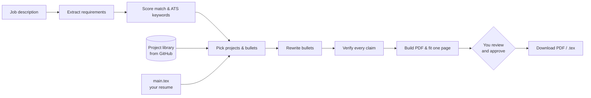

# Job Agent

**A job-application copilot that tailors your resume to each job description — using only things you have actually done.**

Paste a job description and Job Agent scores how well you match, picks your most relevant experience and GitHub projects, rewrites your bullets around the role, verifies every claim against your real background, and builds a one-page PDF. Nothing can be downloaded until the automated checks pass **and** you approve the changes.

It runs locally: a FastAPI backend and a React UI served from one process, with [Groq](https://groq.com) as the language model and [Tectonic](https://tectonic-typesetting.github.io) to build the PDF.

---

## Contents

- [Features](#features)
- [How it works](#how-it-works)
- [How it stays truthful](#how-it-stays-truthful)
- [Getting started](#getting-started)
- [Using the app](#using-the-app)
- [Building your project library from GitHub](#building-your-project-library-from-github)
- [Configuration](#configuration)
- [Project structure](#project-structure)
- [Development](#development)
- [Tests](#tests)
- [Known limitations](#known-limitations)

---

## Features

- **Match score you can trust.** Required skills, preferred skills, project relevance and qualifications, combined with fixed weights. The score is computed in code, not by the model, so the same job and resume always give the same number.
- **ATS keyword check.** Which of the job's keywords appear in your resume, which are partial, which are missing, and whether they sit where applicant-tracking systems look first.
- **Project library from your GitHub.** Every repository is analysed once into a structured record: what it does, architecture, a tech stack verified against the code, what is implemented versus planned, and ten candidate resume bullets.
- **Picks your best projects for each job.** The model reviews *all* your projects (from your resume and GitHub), shortlists the ones that genuinely fit, and chooses at most three distinct bullets per project.
- **Tailored rewriting.** Bullets are rewritten toward the job's wording without adding anything new; a rewrite that loses a skill or a metric is rejected and your original kept.
- **Skills section that matches the job.** When a GitHub project on the page proves a skill the job asks for (say MongoDB) and your Skills section lacks it, it is added to the fitting line — and removed again if that project is trimmed off.
- **Real one-page PDF.** The tailored LaTeX is compiled with Tectonic and the page count is measured. If it overflows, a fixed trim order cuts the least relevant content — never the font size or margins.
- **Review before release.** A line-by-line diff against your original, a live PDF preview (watermarked *DRAFT* until approved), then **Download PDF** or `.tex`.
- **Live progress.** One progress line shows the current stage and percentage while a job runs, counting through bullet rewrites one by one.
- **Referral outreach.** LinkedIn messages, emails and follow-ups written in your voice from your real resume.
- **Application tracker.** Status, notes and a full history for every application.

## How it works



1. **Analyse** — the model extracts structured requirements from the posting; code maps them to a skill vocabulary and computes the score.
2. **Select** — code pre-ranks every project; the model reviews the full list, shortlists, then picks up to three bullets per chosen project. The model returns ids only, and code validates each one.
3. **Rewrite** — the selected bullets are rephrased toward the job's terminology in a single model call, each using only the facts already in it; every returned line is then checked on its own.
4. **Verify** — every rewritten line is checked against your resume and project library before it can reach the page.
5. **Fit** — the result is spliced into a copy of your `main.tex`, compiled, measured and trimmed to one page.
6. **Approve** — you review the diff and the PDF; approval unlocks the download.

## How it stays truthful

Resume tools fail when they invent experience. Job Agent is built so that the model **never decides what is true** — code does:

| Guardrail | What it does |
|---|---|
| Extract, then rewrite | Code decides what goes on the page; the model only rephrases text it is given, one bullet at a time. |
| Number masking | Numbers are replaced with placeholders before every model call. Any digit the model writes itself is rejected. |
| Claim whitelist | Every technology named in the output must already appear in your resume or project library — otherwise the resume is blocked. |
| Verified project records | When the library is built, technologies not found in the repository are dropped, bullets naming them are rejected, and metrics must trace to the repository. Bullets claiming an artefact — a Dockerfile, tests, CI, Kubernetes, a cloud deployment — are rejected unless the repository actually contains it. |
| Authorship check | Forks, downloaded archives and code owned by someone else are kept off your resume until you confirm they are yours. |
| Two-gate release | Downloads require the automated checks to pass **and** your approval. Approval is tied to the exact content, so re-tailoring revokes it. |

## Getting started

### Prerequisites

- **Windows** (the run script and paths assume it; the code itself is portable)
- **Python 3.12+** from [python.org](https://www.python.org/downloads/) — not the Microsoft Store build
- **Node.js 18+**
- A **Groq API key** — free at [console.groq.com](https://console.groq.com)

### 1. Install

```cmd
git clone https://github.com/Suryakausthub/Agent.git
cd Agent
python -m venv .venv
.venv\Scripts\python -m pip install -r backend\requirements.txt
cd frontend && npm install && cd ..
copy .env.example .env
```

Open `.env` and set `GROQ_API_KEY`. Optionally add a read-only `GITHUB_TOKEN` (classic token, `public_repo` scope) — it lets the project library check README and authorship details for your repositories.

### 2. Add your resume and profile

- **`main.tex`** — put your master resume at the project root. It is not in this repository because it holds personal contact details. The parser understands the common *Jake's Resume* LaTeX template (`\resumeSubheading`, `\resumeProjectHeading`, `\resumeItem`) with sections named **Summary**, **Technical Skills**, **Experience**, **Projects** and **Education** (plus optional **Certifications & Achievements** and **Research Publications**). Your `main.tex` is only read, never modified.
- **`backend/data/config.yaml`** — set your name, email, LinkedIn and GitHub in the `candidate:` section. These sign your referral messages.

### 3. Install Tectonic (for the PDF)

Tectonic is not committed (~50 MB). Download it into `tools\tectonic\`:

```powershell
New-Item -ItemType Directory -Force tools\tectonic | Out-Null
Invoke-WebRequest "https://github.com/tectonic-typesetting/tectonic/releases/download/tectonic%400.15.0/tectonic-0.15.0-x86_64-pc-windows-msvc.zip" -OutFile tools\tectonic\t.zip
Expand-Archive tools\tectonic\t.zip tools\tectonic; Remove-Item tools\tectonic\t.zip
```

The first PDF build downloads the LaTeX packages it needs; later builds work offline. Without Tectonic the app still runs, but page counts are estimated and PDF download is unavailable.

### 4. Run

```cmd
run.cmd
```

Double-click it or run it from a terminal. It builds the UI if needed, frees the port if an old run is still holding it, starts the server and opens **http://localhost:8000**. Press **Ctrl+C** to stop. Use another port with `run.cmd 8123`.

> Use `run.cmd`, not `run.ps1` — PowerShell's default execution policy blocks unsigned scripts.

After pulling new code, **restart** `run.cmd` so the server and UI match; the app shows a banner if they don't.

## Using the app

1. **New application** — paste the job description, or a link to a Workday, Greenhouse, Lever or Ashby posting, and press **Analyse job**. You get the match score, skills you have and are missing, and keyword coverage.
2. **Tailor resume** — Job Agent picks your strongest projects, rewrites the bullets and builds the PDF. The progress line shows each stage live.
3. **Resume tab** — review every change next to its source, alongside the PDF preview. Press **Approve**, then **Download PDF** (or `.tex` / **Copy LaTeX** for Overleaf).
4. **Outreach tab** — generate a referral message for LinkedIn, email or a follow-up.
5. **Activity tab** — track the application's status, keep notes and see its history.

The **Project library** lists your analysed GitHub projects. They are used automatically; mark any project **Don't use**, or confirm a flagged one with **Use anyway**. Open a project to read its full record and edit its bullets.

## Building your project library from GitHub

Three one-time steps, run from the project root. Each is safe to re-run and skips work already done.

```cmd
:: 1. discover your public repositories and classify them (keep / review / exclude)
.venv\Scripts\python backend\scripts\extract_github.py --user YOUR_GITHUB_USERNAME

:: 2. collect facts from each repository: manifests, README, key source files
.venv\Scripts\python backend\scripts\harvest_evidence.py

:: 3. build a verified record per repository (one model call each)
.venv\Scripts\python backend\scripts\build_knowledge_base.py
```

Each record holds the project's description and the problem it solves, architecture and components, a categorised tech stack checked against the code, implementation details marked *implemented / partial / planned*, key contributions, **ten candidate resume bullets** with the files that support them, keywords, and any **gaps** the evidence could not settle.

To re-check existing records against the latest verification rules (no model calls; shows what would change, then `--apply`):

```cmd
.venv\Scripts\python backend\scripts\recheck_knowledge_base.py
```

To pick up repositories you have pushed to since, run:

```cmd
.venv\Scripts\python backend\scripts\build_knowledge_base.py --sync
```

Groq's free tier allows 8,000 tokens per minute, so the build runs one repository about every 75 seconds. If a run stops (rate limit, network), just run it again. Your hand edits are never overwritten unless you pass `--force`.

## Configuration

Everything tunable lives in `backend/data/config.yaml`:

| Setting | Default | What it does |
|---|---|---|
| `llm.model` | `openai/gpt-oss-120b` | Groq model; `fallback_model` is used if it is unavailable. |
| `scoring.weights` | 50 / 20 / 20 / 10 | Required skills / preferred skills / project relevance / qualifications. Must sum to 1.0. |
| `resume.max_projects` | `3` | Projects on the page (the trim step may drop to `min_projects`). |
| `resume.protected_sections` | Summary, Education, Certifications, Publications | Never removed to save space. |
| `resume.trim_order` | summary → skills → project → experience bullet | What is cut first when the page overflows. |
| `project_bank.require_approval` | `false` | `true` = only projects you approve are used. |
| `project_bank.exclude_flagged` | `true` | Keep projects with uncertain authorship off until you confirm them. |
| `project_bank.max_bullets_per_project` | `3` | Bullets per project on the final resume. |
| `compile.backend` | `tectonic` | `tectonic` measures the real PDF; `stub` estimates. `fallback_to_stub` estimates if Tectonic cannot run. |
| `candidate` | — | Your name and contact details for referral messages. |

`backend/data/vocabulary.yaml` holds the skill vocabulary (111 terms with aliases and "implies" rules) used for scoring; edit it to teach the matcher new skills.

## Project structure

```
Agent/
├── run.cmd                     # one-command start (Windows)
├── main.tex                    # your master resume (not committed)
├── backend/
│   ├── app/
│   │   ├── main.py             # FastAPI routes; also serves the built UI
│   │   ├── pipeline.py         # analyse → select → rewrite → verify → fit
│   │   ├── db.py               # SQLite: jobs, approval gate, projects
│   │   ├── progress.py         # live stage events (server-sent events)
│   │   └── core/
│   │       ├── jd_extract.py   # job description → structured requirements
│   │       ├── scoring.py      # deterministic match score
│   │       ├── ats.py          # keyword coverage
│   │       ├── knowledge_base.py   # verified project records
│   │       ├── project_select.py   # project & bullet selection
│   │       ├── tailor.py       # bullet / summary rewriting
│   │       ├── whitelist.py    # claim verification
│   │       ├── render.py       # splice edits into main.tex
│   │       ├── trim.py         # fit to one page
│   │       ├── compile.py      # Tectonic PDF + page count
│   │       └── llm.py          # Groq client, number masking, retries
│   ├── data/                   # config.yaml, vocabulary.yaml
│   ├── scripts/                # GitHub library build steps
│   └── tests/
└── frontend/                   # React + Vite UI
    └── src/
        ├── pages/              # Applications, New application, Job, Library
        ├── tabs/               # Overview, Resume, Keywords, Outreach, Checks, Activity
        └── components/         # progress line, shared UI
```

Interactive API docs are at **http://localhost:8000/docs** while the app is running.

## Development

To work on the UI with hot reload, run the backend and Vite separately:

```cmd
cd backend
..\.venv\Scripts\python -m uvicorn app.main:app --port 8000 --reload
```
```cmd
cd frontend
npm run dev
```

Open **http://localhost:5173** (Vite proxies `/api` to port 8000). Run `npm run build` when you are done so `run.cmd` serves your changes.

If port 8000 is stuck, `run.cmd` clears it automatically, or by hand:

```powershell
Get-NetTCPConnection -LocalPort 8000 -State Listen |
  Select-Object -Expand OwningProcess | ForEach-Object { Stop-Process -Id $_ -Force }
```

## Tests

```cmd
.venv\Scripts\python -m pytest          :: offline suite - free, about 25 seconds
.venv\Scripts\python -m pytest --live   :: also the model and live job-board tests
```

Each check is also a readable script you can run on its own to see what it verifies:

```cmd
:: offline
.venv\Scripts\python backend\tests\t_parse.py      :: LaTeX parser against main.tex
.venv\Scripts\python backend\tests\t_vocab.py      :: skill extraction and implications
.venv\Scripts\python backend\tests\t_pagefit.py    :: page-estimate calibration
.venv\Scripts\python backend\tests\t_compile.py    :: Tectonic PDF, measured pages, trim, fallback
.venv\Scripts\python backend\tests\t_kb.py         :: project records, selection, rendering, scoring
.venv\Scripts\python backend\tests\t_batch.py      :: batched bullet rewriting and its per-line safeguards
.venv\Scripts\python backend\tests\t_skills.py     :: proven skills on the Skills section, artefact checks

:: real model calls (a fraction of a cent each)
.venv\Scripts\python backend\tests\t_llm.py        :: API key works, number masking
.venv\Scripts\python backend\tests\t_score.py      :: job description → score
.venv\Scripts\python backend\tests\t_tailor.py     :: rewriting + claim check (incl. injected fake skills)
.venv\Scripts\python backend\tests\t_render.py     :: render, trim and re-parse
.venv\Scripts\python backend\tests\t_api.py        :: full API including the approval gate
.venv\Scripts\python backend\tests\t_paste.py      :: pasted job description through the API
.venv\Scripts\python backend\tests\t_stability.py  :: identical input → identical score
.venv\Scripts\python backend\tests\t_live.py <url> :: fetch a live posting end to end

:: network only (no model calls)
.venv\Scripts\python backend\tests\t_fetch.py      :: Greenhouse / Lever / Ashby links, closed postings
```

`t_api`, `t_paste` and `t_live` create applications in your local database, so pytest never runs them — run them by hand, then delete the test applications (or back up `job_agent.db` first). Leave about a minute between model-backed tests to stay within Groq's free-tier limit.

## Known limitations

- **Job links:** Workday, Greenhouse, Lever and Ashby postings are fetched through their public APIs, including company career pages built on them. LinkedIn and most other sites render in the browser or block automated requests, so paste those descriptions instead.
- **Groq free tier:** 8,000 tokens per minute and 200,000 per day. Tailoring one job uses a noticeable share; heavy use in one day can hit the daily cap.
- **PDF engine:** Tectonic uses XeTeX while Overleaf uses pdfLaTeX. The compiled copy drops the pdfTeX-only `\input{glyphtounicode}` line and maps `★` to `$\star$`; line breaks can differ very slightly from Overleaf.
- **LinkedIn:** there is no API for sending messages, so outreach is generated for you to copy and send.
- **Score changes with wording:** extraction is stable for identical text but can shift when the posting text changes. Each application's extraction is cached, so its score does not move once computed.
- **GitHub project dates:** library projects appear without a date, since a repository's activity dates are not the project's dates.
